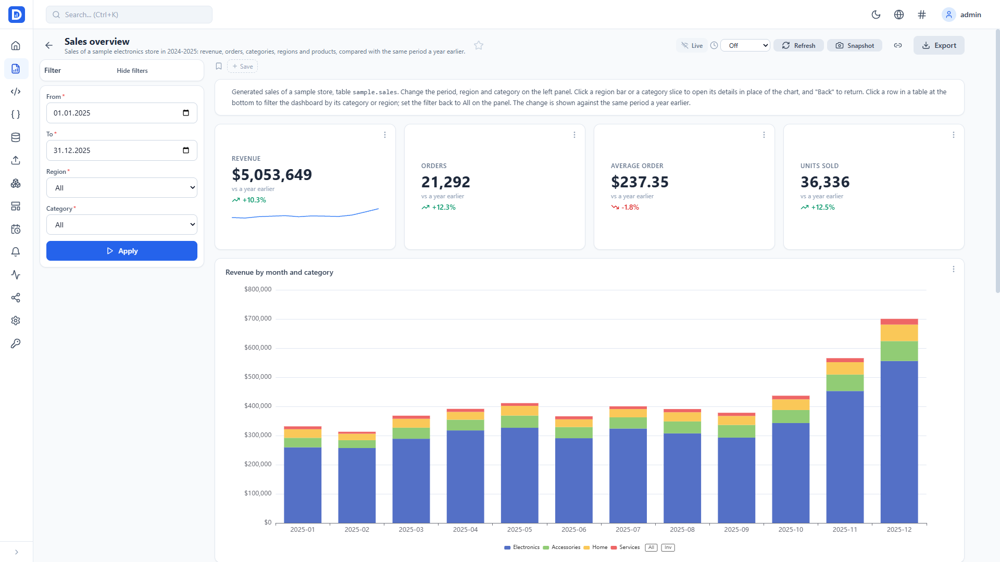
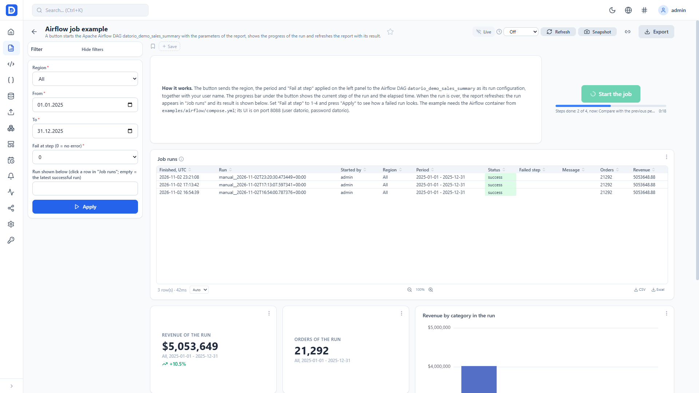
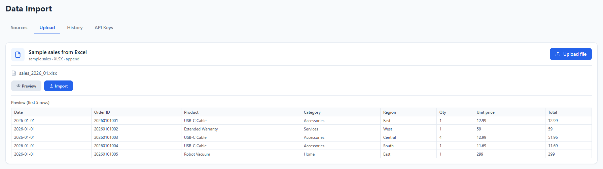
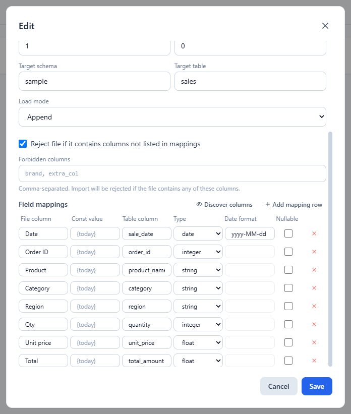
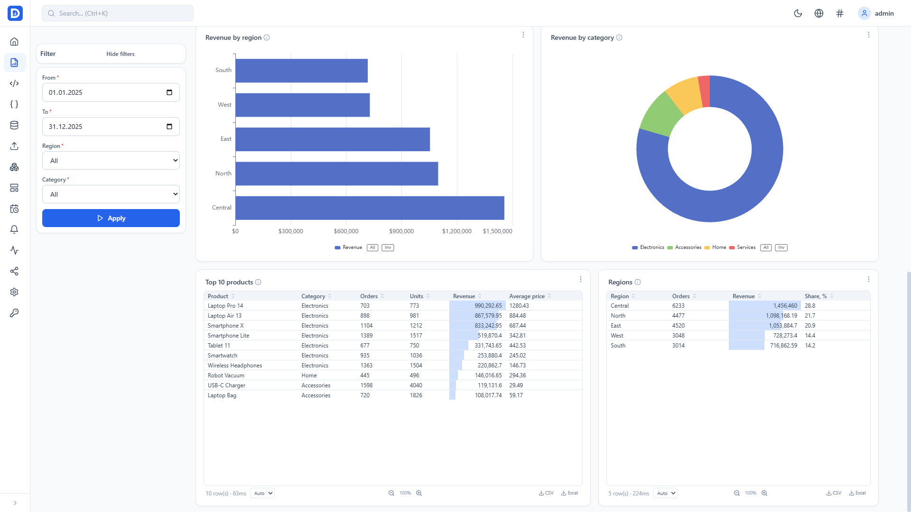
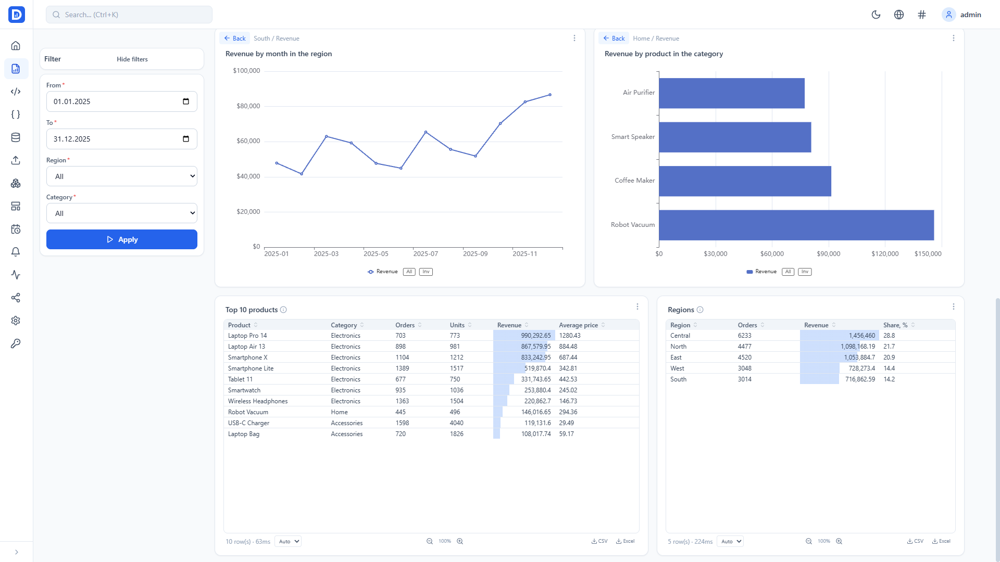
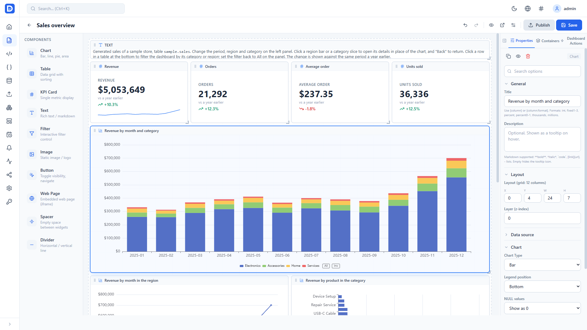

#  Datorio

**Self-hosted, open-source BI for PostgreSQL and ClickHouse.** Build reports and dashboards in a visual designer, start Apache Airflow DAGs from a button on a report, and load Excel, CSV, JSON and ZIP files into your database. Everything runs in one Docker container.

[](https://github.com/datorio-bi/datorio/actions/workflows/ci.yml)
[](LICENSE)
[](https://github.com/datorio-bi/datorio/pkgs/container/datorio)
[](https://codespaces.new/datorio-bi/datorio?quickstart=1)



## Highlights

### Run Airflow DAGs from a report

Put a **Start a job** button on a report, and business users can start an Apache Airflow DAG without opening Airflow:

- the applied report parameters become the configuration of the DAG run; numbers, lists and booleans keep their types;
- the name of the user who pressed the button, and their email, can be passed to the DAG as well;
- a progress bar under the button shows the current task, the completed steps and the elapsed time, names the task that failed, and the report refreshes when the run is over;
- the button can stay unavailable until the required parameters are applied or until a given table shows rows, with the reason shown under it;
- only DAGs from an allow-list can be started; Datorio talks to the Airflow 3 REST API with a service account.



### Load data from files

An import source describes how a file lands in a PostgreSQL or ClickHouse table:

- formats: Excel (.xlsx), CSV, TSV, JSON (with a path to the array of records), and ZIP archives with several files selected by a file name pattern;
- sheet, header row, rows to skip and file encoding;
- column mapping with data types, date formats, constant values and nullability, plus a strict column set and forbidden columns;
- load modes: append, replace, or upsert by key columns;
- preview before loading, and an import history with row-level errors;
- upload from the UI, or from scripts and other systems with an API key.





## Features

**Reports and dashboards**
- Drag-and-drop report designer on Apache ECharts: bar, line, area, pie, scatter, funnel, gauge, heatmap, radar, sankey, treemap, boxplot, candlestick, waterfall, KPI cards and tables
- Parameter panel with required fields and collapsible groups, cross-filtering, drill-down between reports with parameter passing
- Interactive dashboards: chart layers, dynamic zones, containers, rich tooltips, buttons that navigate, show or hide widgets, filter, export, open a URL or run a job; reports also show overlays and annotations created through the API or a report import
- Data modeling layer: a semantic model with automatic joins and an Explore view
- Calculated fields, bookmarks, reports and templates exported and imported as JSON; an import can replace the content of an existing report, which keeps its link, access and schedules
- Live updates over Server-Sent Events
- Server-side JavaScript (sandboxed GraalJS) to transform chart data

**Sharing and operations**
- Export to CSV, Excel and PDF, send a report by email, embed reports with tokens
- Scheduled reports (cron) emailed to their recipients, and data alerts by email or webhook with a history of triggered and resolved events
- Performance monitoring and a query advisor
- Roles (ADMIN, EDITOR, VIEWER, IMPORTER), object-level permissions and sharing, folders, favorites, tags and global search
- Interface in 28 languages; translation fixes are welcome, see [Translations](#translations). Number and date format chosen apart from the language, the browser's by default. Light and dark themes
- REST API with OpenAPI documentation (Swagger UI)

## Screenshots

Charts and tables of the example report; a click on a table row filters the dashboard by its region or category:



A click on a region bar or a category slice opens its details in place of the chart, with "Back" to return:



The report designer with the property panel of a chart:



## Quick start

### Try it in the browser

[](https://codespaces.new/datorio-bi/datorio?quickstart=1)

A GitHub Codespace starts Datorio with the sample data, the Airflow example and the example reports by itself, on every start. When the notification about port 8080 appears (a few minutes on the first start), open it and sign in with `admin` / `admin`; the Ports tab lists Datorio (8080) and the Airflow UI (8088). The codespace runs the published image of `main`.

### Run it on your machine

Requirements: Docker with Docker Compose.

```bash
git clone https://github.com/datorio-bi/datorio.git
cd datorio
cp .env.example .env      # set ADMIN_PASSWORD and JWT_SECRET
docker compose up -d
```

Open http://localhost:8080 and sign in with `ADMIN_USER` / `ADMIN_PASSWORD` from `.env` (`admin` / `admin` by default).

The example values of `.env.example` are for trying the product on your own machine. Before anyone else can reach the installation, set a random `JWT_SECRET` (`openssl rand -base64 48`) and a real `ADMIN_PASSWORD`; the application logs a warning at startup while they are the example ones. Give the data sources read-only database accounts: a report author writes SQL that runs with them.

The stack also starts PostgreSQL for the application metadata and a ClickHouse server with two years (2024-2025) of generated sample data: orders in `sample.sales` and website visits in `sample.page_views`.

### Load the examples

```bash
python3 examples/load_examples.py
```

The script waits for Datorio and creates:

- the ClickHouse data source "Sample ClickHouse" for the sample tables;
- the reports **Sales overview** (KPIs against the previous year, revenue by month, region and category, top products) and **Website analytics** (sessions by week and device, traffic sources, landing pages, a purchase funnel, countries); in Sales overview, click a region or a category on its chart to open the region by month or the products of the category in place of the chart, and **Back** to return; click a row in a table to filter the whole report by it;
- the report **Airflow job example**, see [Try it with the example](#try-it-with-the-example);
- the import source "Sample sales from Excel": upload [`examples/sales_2026_01.xlsx`](examples/sales_2026_01.xlsx) with it on the **Upload** tab of **Data Import** to add the January 2026 orders to `sample.sales`, then set the period of **Sales overview** to end in 2026 to see them.

It reads `ADMIN_USER`, `ADMIN_PASSWORD`, `APP_PORT` and `CH_PASSWORD` from `.env` and skips what already exists, so it can be run again; `--replace` imports the example reports again over the ones of the same names, for example after `git pull`.

The API documentation is at http://localhost:8080/api/docs/swagger.

A ready image of the `main` branch is published as `ghcr.io/datorio-bi/datorio:latest`, and each release as its version, for example `ghcr.io/datorio-bi/datorio:1.1.0`.

## Connect Apache Airflow

### Try it with the example

[`examples/airflow/compose.yml`](examples/airflow/compose.yml) adds a single-container Airflow 3 with the DAG [`datorio_demo_sales_summary`](examples/airflow/dags/datorio_demo_sales_summary.py) and connects Datorio to it:

```bash
docker compose -f docker-compose.yml -f examples/airflow/compose.yml up -d
python3 examples/load_examples.py
```

Open the report **Airflow job example** and press **Start the job**. The region and period from the parameter panel and your user name go to the DAG as its run configuration; the progress bar under the button shows each of the four steps and the elapsed time. The DAG summarizes the sales by category, compares them with the previous period and writes the result to ClickHouse; when the run is over, the report refreshes and shows it, and a click on a row of "Job runs" shows the result of that run. Set "Fail at step" to a step number to see how a failed run is reported. The Airflow UI is at http://localhost:8088 (user `datorio`, password `datorio`).

### Connect your Airflow

Set the Airflow connection in `.env` and run `docker compose up -d` again to recreate the container:

```bash
AIRFLOW_API_URL=http://airflow-apiserver:8080   # Airflow 3 API server
AIRFLOW_API_USER=datorio_service
AIRFLOW_API_PASSWORD=change_me
AIRFLOW_ALLOWED_DAGS=example_dag_id,another_dag_id
```

Then add a **Button** widget to a report, choose the **Start a job** type and fill in its fields (the widget config key is in brackets):

| Designer field | Meaning |
|----------------|---------|
| Job (Airflow DAG id) (`jobId`) | the DAG to start; it must be listed in `AIRFLOW_ALLOWED_DAGS` |
| Report parameters to send (`jobParams`) | the parameters passed to the DAG; all of them when none is chosen |
| Job parameter for the user name (`jobUserParam`) | receives the name of the user who pressed the button |
| Job parameter for the user email (`jobEmailParam`) | receives the user's email when the report leaves it empty |
| Required parameters (`requiredParams`) | the button is unavailable until these parameters are applied |
| Widget title (`requireRowsIn`) | the button is unavailable while that widget has no rows |
| Confirmation question (`confirmText`) | asked before the start |

For a report with the parameters `date_from` and `region` (a multi-select) and `jobUserParam` set to `requested_by`, the DAG run receives a configuration like:

```json
{"date_from": "2026-10-01", "region": ["North", "South"], "requested_by": "alice"}
```

See the [deployment guide](docs/DEPLOYMENT.md) for the Airflow role the service account needs.

## Upload files from scripts

Generate an API key in **Data Import** > **API Keys**, then send a file to an import source:

```bash
curl -X POST http://localhost:8080/api/import/sources/{source_id}/upload \
  -H "Authorization: Bearer dat_YOUR_API_KEY" \
  -F "file=@data.xlsx"
```

The response reports the rows imported and failed; `GET /api/import/logs/{id}/errors` returns the row-level errors.

## Documentation

- [Deployment guide](docs/DEPLOYMENT.md): production setup, reverse proxy, Airflow, the import API, the scripting sandbox and environment variables
- [Development roadmap](docs/development/PROJECT_ROADMAP.md): how the platform was built, phase by phase

## Tech stack

| Component | Technology |
|-----------|------------|
| Backend | Kotlin, Spring Boot 3 |
| Frontend | React, TypeScript |
| Charts | Apache ECharts 5 |
| Scripting | GraalJS (server), sandbox (client) |
| Auth | Spring Security, JWT, API keys |
| Metadata | PostgreSQL |
| Data sources | PostgreSQL, ClickHouse |
| Build | Gradle (Kotlin DSL), Vite |

## Local development

```bash
docker compose up -d postgres clickhouse

# backend: the compose file publishes PostgreSQL on 5433 with the password of .env
DB_PORT=5433 DB_PASSWORD=datorio_secret ./gradlew :backend:bootRun

# frontend
cd frontend
npm install
npm run dev
```

## Contributing

Bug reports, ideas and pull requests are welcome: open an [issue](https://github.com/datorio-bi/datorio/issues) or a pull request.

### Translations

The interface texts are in [`frontend/src/i18n/locales`](frontend/src/i18n/locales), one JSON file per language; `en.json` is the reference. Many translations have not been read by native speakers yet, so a pull request that fixes a wording in your language is a welcome first contribution. Keep the keys and the `{{placeholders}}` as they are; `python3 .github/scripts/check_locales.py` checks that every locale has the keys and placeholders of `en.json` (CI runs it too).

## License

MIT, see [LICENSE](LICENSE).
